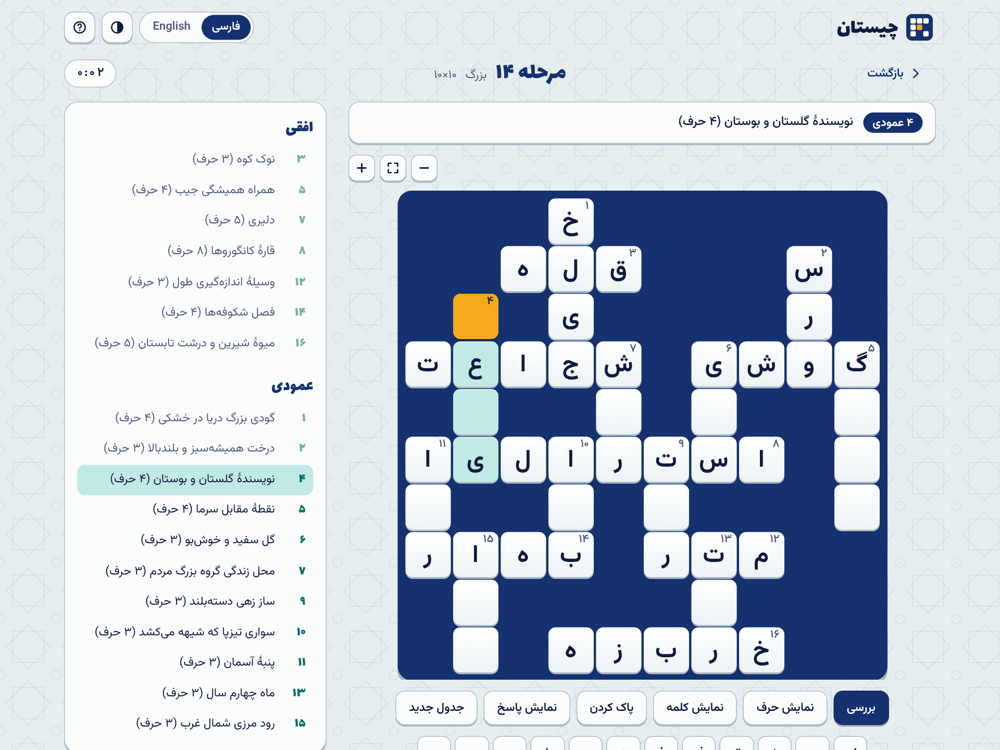
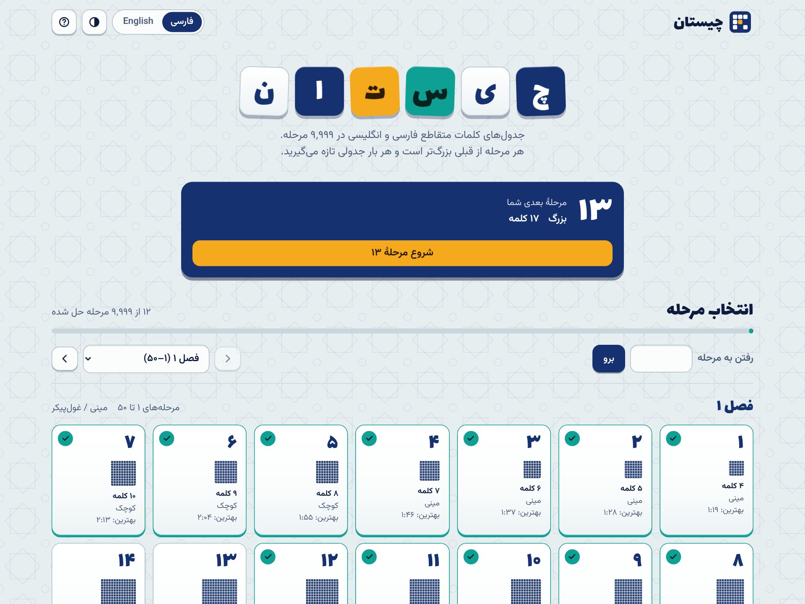
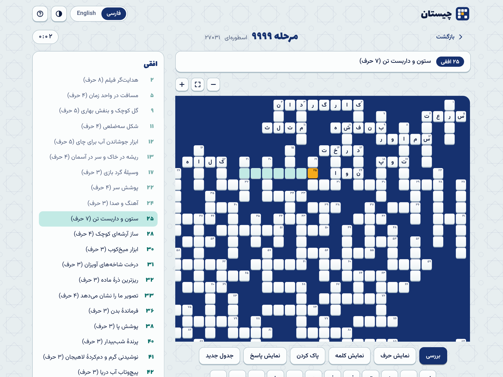
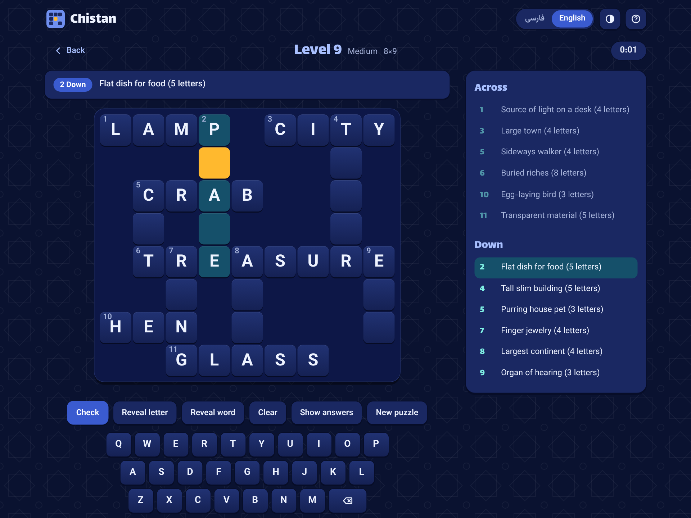
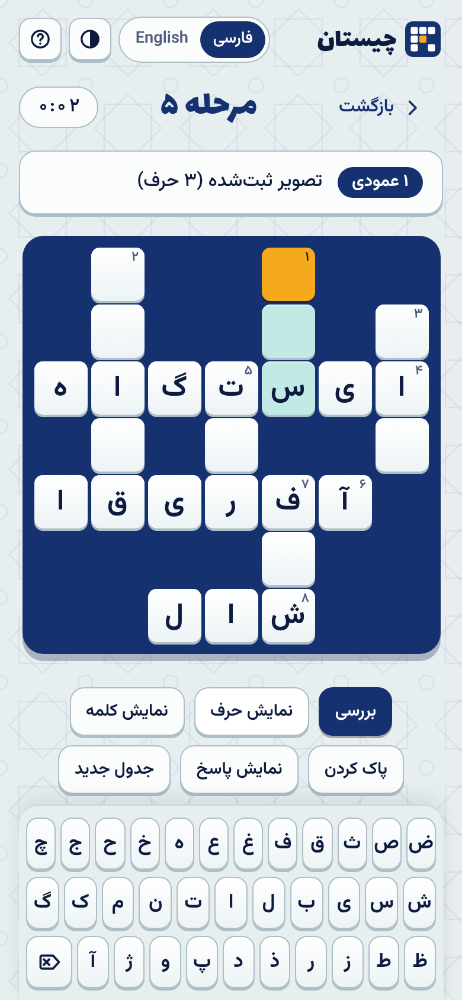

<div align="center">

# چیستان · Chistan

**بازی جدول کلمات متقاطع فارسی و انگلیسی، با ۹٬۹۹۹ مرحله و جدول‌های تصادفی و بدون تکرار**
**A bilingual Persian and English crossword game with 9,999 levels and random, never-repeating puzzles**

[فارسی](#fa) &nbsp;|&nbsp; [English](#en)



</div>

---

<a id="fa"></a>

<div dir="rtl">

# فارسی

«چیستان» یک بازی جدول کلمات متقاطع است که کاملاً در مرورگر اجرا می‌شود. هر جدول یک شبکهٔ کلمات به‌هم‌پیوسته است. سرنخ‌های افقی و عمودی را می‌خوانید و پاسخ را حرف‌به‌حرف در خانه‌ها می‌نویسید. بازی به دو زبان فارسی (راست‌به‌چپ) و انگلیسی (چپ‌به‌راست) کار می‌کند و هیچ وابستگی یا مرحلهٔ ساخت (build) ندارد.

## ویژگی‌ها

- **۹٬۹۹۹ مرحله که پیوسته بزرگ‌تر می‌شوند.** از جدول ۶×۶ با ۴ کلمه در مرحلهٔ ۱ تا جدولی با ۱۲۰ کلمه (تا ۴۱×۴۱) در مرحلهٔ ۹٬۹۹۹. مرحله‌ها در هشت دستهٔ مینی، کوچک، متوسط، بزرگ، غول‌پیکر، حماسی، افسانه‌ای و اسطوره‌ای قرار دارند. شمارش مرحله‌ها در ۲۰۰ فصل ۵۰تایی است و با «رفتن به مرحله» مستقیم به هر شماره می‌روید.
- **تعداد کلمه با پیشروی زیاد می‌شود.** در ۲۰ مرحلهٔ اول در هر مرحله یک کلمه اضافه می‌شود، بعد از آن آهنگ رشد کندتر می‌شود (جدول «مرحله‌ها» را ببینید).
- **تولید تصادفی و بی‌پایان.** با هر شروع مرحله یک جدول تازه ساخته می‌شود، پس هر مرحله به‌جای یک جدول ثابت، تعداد نامحدودی جدول دارد.
- **بدون تکرار.** بازی کلمه‌های اخیر و امضای چیدمان جدول‌های قبلی را در مرورگر شما نگه می‌دارد و از تکرار آن‌ها پرهیز می‌کند. در آزمایش ۱۲۰ جدول پشت‌سرهم (از مرحلهٔ ۱ تا ۹٬۹۹۹) برای هر زبان، هیچ جدول تکراری ساخته نشد، و ۴۰ بار بازی کردن مرحله‌های ۱، ۲۰، ۵۰۰ و ۹٬۹۹۹ هم چیدمان تکراری نداشت. دو جدول متوالی به‌طور میانگین کمتر از ۲ درصد کلمه‌هایشان مشترک بود.
- **هر دو زبان.** بانک واژگان فارسی (۶۶۷ کلمه) و انگلیسی (۷۱۶ کلمه)، همه با سرنخ، و کیبورد مجازی مخصوص هر زبان. در حالت فارسی، اگر کیبورد دستگاه انگلیسی باشد، کلیدها به چیدمان استاندارد فارسی تبدیل می‌شوند.
- **جدول‌های بزرگ هم قابل بازی‌اند.** دکمه‌های + و − جدول را بزرگ و کوچک می‌کنند، جدول با اسکرول جابه‌جا می‌شود و خانهٔ انتخاب‌شده خودکار در دید می‌ماند.
- **ابزار کمکی.** بررسی خانه‌های اشتباه، نمایش یک حرف، نمایش یک کلمه، پاک کردن، نمایش پاسخ کامل.
- **ذخیرهٔ خودکار.** بازی نیمه‌کاره، زمان، بهترین رکورد هر مرحله و پیشرفت شما در مرورگر ذخیره می‌شود (به تفکیک زبان).
- **رابط زیبا و واکنش‌گرا.** طراحی با الهام از کاشی‌کاری ایرانی، پوستهٔ روشن و تیره، فونت‌های فارسی داخل پروژه (کار آفلاین هم می‌کند)، مناسب موبایل و دسکتاپ.
- **دسترس‌پذیر.** کار با کیبورد، فوکوس مشخص، پشتیبانی از `prefers-reduced-motion`.

<table>
  <tr>
    <td></td>
    <td></td>
    <td></td>
    <td></td>
  </tr>
</table>

## اجرا

ساده‌ترین راه: فایل `index.html` را در مرورگر باز کنید.

یا با یک سرور محلی کوچک (نیاز به Node.js نسخهٔ ۱۶ به بالا):

```bash
git clone https://github.com/<your-user>/chistan-crossword.git
cd chistan-crossword
npm start            # سپس http://localhost:8080 را در مرورگر باز کنید
```

### انتشار روی GitHub Pages

۱. پروژه را روی GitHub push کنید.
۲. در مخزن به **Settings ← Pages** بروید.
۳. در بخش Source گزینهٔ **Deploy from a branch** را انتخاب کنید، شاخهٔ `main` و پوشهٔ `/ (root)` را بزنید و ذخیره کنید.
۴. بعد از چند دقیقه بازی در `https://<your-user>.github.io/chistan-crossword/` در دسترس است.

## راهنمای بازی

| کار | روش |
|---|---|
| انتخاب خانه | کلیک یا لمس خانه |
| تغییر جهت (افقی/عمودی) | دوباره روی همان خانه بزنید، یا کلید `Space` |
| وارد کردن حرف | کیبورد صفحه یا کیبورد دستگاه |
| حذف حرف | `Backspace` یا دکمهٔ حذف روی کیبورد صفحه |
| حرکت بین خانه‌ها | کلیدهای جهت‌دار |
| سرنخ بعدی / قبلی | `Enter` / `Shift`+`Enter` |
| رفتن به یک سرنخ | کلیک روی آن در فهرست سرنخ‌ها |
| رفتن به یک مرحله | عدد را در کادر «رفتن به مرحله» بنویسید (ارقام فارسی و انگلیسی هر دو پذیرفته می‌شوند) |
| بزرگ و کوچک کردن جدول | دکمه‌های + و − بالای جدول، و دکمهٔ میانی برای اندازهٔ مناسب صفحه |

نکته: «نمایش حرف» و «نمایش کلمه» در رکورد زمان ثبت می‌شوند و جدولی که با کمک حل شود، رکورد جدید ثبت نمی‌کند. «نمایش پاسخ» جدول را در پیشرفت شما حل‌شده حساب نمی‌کند.

## مرحله‌ها

| دسته | مرحله‌ها | سقف اندازهٔ جدول | تعداد کلمه |
|---|---|---|---|
| مینی | ۱ تا ۴ | ۶×۶ تا ۸×۸ | ۴ تا ۷ |
| کوچک | ۵ تا ۸ | ۹×۹ تا ۱۱×۱۱ | ۸ تا ۱۱ |
| متوسط | ۹ تا ۱۲ | ۱۱×۱۱ تا ۱۳×۱۳ | ۱۲ تا ۱۵ |
| بزرگ | ۱۳ تا ۱۶ | ۱۴×۱۴ تا ۱۶×۱۶ | ۱۷ تا ۲۲ |
| غول‌پیکر | ۱۷ تا ۱۱۳ | ۱۷×۱۷ تا ۲۴×۲۴ | ۲۴ تا ۴۰ |
| حماسی | ۱۱۴ تا ۱٬۰۶۸ | ۲۴×۲۴ تا ۲۹×۲۹ | ۴۱ تا ۶۰ |
| افسانه‌ای | ۱٬۰۶۹ تا ۴٬۴۳۹ | ۲۹×۲۹ تا ۳۶×۳۶ | ۶۱ تا ۹۰ |
| اسطوره‌ای | ۴٬۴۴۰ تا ۹٬۹۹۹ | ۳۶×۳۶ تا ۴۱×۴۱ | ۹۱ تا ۱۲۰ |

**قاعدهٔ رشد.** ۲۰ مرحلهٔ اول دستی تنظیم شده‌اند. از مرحلهٔ ۲۱ به بعد:

```
کلمه‌ها = ۳۲ + گرد( ۰٫۸۸ × √(مرحله − ۲۰) )
اندازهٔ جدول = سقف( ۲۱ × √(کلمه‌ها / ۳۲) )
```

پس تعداد کلمه همیشه صعودی است و هرگز بیش از یک کلمه در هر مرحله بالا نمی‌رود، اما رشد کند می‌شود. به‌طور میانگین: از مرحلهٔ ۲۰ تا ۱۰۰ هر ۱۰ مرحله یک کلمه، از ۱۰۰ تا ۵۰۰ هر حدود ۳۶ مرحله، از ۱٬۰۰۰ تا ۳٬۰۰۰ هر ۱۰۰ مرحله و از ۶٬۰۰۰ تا ۹٬۹۹۹ هر حدود ۲۰۰ مرحله. سقف ۱۲۰ کلمه با اندازهٔ بانک واژگان و زمان ساخت جدول (که باید در حد کسری از ثانیه بماند) انتخاب شده است. برای رشد تندتر یا سقف بالاتر، ثابت‌های `GROWTH` و `BASE_LEVELS` را در `js/generator.js` عوض کنید و بانک واژگان را بزرگ‌تر کنید.

جدول ساخته‌شده همیشه به‌اندازهٔ کلمه‌های خودش جمع‌وجور می‌شود، پس ابعاد واقعی کمی از این سقف کمتر است (در آزمون‌ها ضلع بلندتر جدول مرحلهٔ ۹٬۹۹۹ بین ۳۰ تا ۳۴ خانه بود). تابع `levelConfig(n)` در `js/generator.js` مشخصات هر مرحله را برمی‌گرداند.

## تولید جدول چطور کار می‌کند؟

۱. یک عدد تصادفی (seed) با `crypto.getRandomValues` انتخاب می‌شود و تولیدکنندهٔ اعداد شبه‌تصادفی `mulberry32` از آن ساخته می‌شود. با یک seed ثابت، همیشه همان جدول ساخته می‌شود و این برای تست و بازتولید جدول‌ها مفید است.
۲. کلمه‌های مناسب مرحله (بر اساس طول) از بانک واژگان جدا می‌شوند. کلمه‌هایی که اخیراً استفاده شده‌اند در انتهای صف می‌روند. هرچه مرحله بزرگ‌تر باشد، بانک بزرگ‌تری از کلمه‌های مجاز لازم است و بازی ۶۰ درصد بانک را به‌عنوان «اخیراً استفاده‌شده» نگه می‌دارد.
۳. یک کلمهٔ بلند نزدیک مرکز گذاشته می‌شود و بقیه یکی‌یکی به‌صورت متقاطع اضافه می‌شوند. هر گزینهٔ چیدمان فقط وقتی پذیرفته می‌شود که با هیچ کلمهٔ دیگری کنار هم نچسبد و فقط در نقطهٔ تقاطع‌های درست حرف مشترک داشته باشد.
۴. این کار چند بار با ترتیب متفاوت تکرار می‌شود و بهترین نتیجه (رسیدن به تعداد کلمهٔ هدف، تقاطع بیشتر، جدول جمع‌وجور و نزدیک به مربع) انتخاب می‌شود.
۵. اگر امضای جدول (هش FNV-1a از کلمه‌ها و جایگاه‌هایشان) قبلاً دیده شده باشد، جدول دوباره ساخته می‌شود.
۶. تابع `validate` جدول نهایی را مستقل بازبینی می‌کند: حرف‌ها، مرزها، هم‌پیوستگی و نبودن کلمهٔ ناخواسته.

روی یک رایانهٔ رومیزی، ساخت جدول در آزمون ما به‌طور میانهٔ حدود ۵۰ میلی‌ثانیه طول کشید. بزرگ‌ترین مرحله‌ها (۹٬۹۹۸ و ۹٬۹۹۹ با ۱۲۰ کلمه) حدود ۰٫۲ تا ۰٫۳ ثانیه می‌گیرند. روی گوشی‌های قدیمی‌تر ممکن است بیشتر باشد.

## افزودن کلمه و سرنخ

فایل‌های `js/words-fa.js` و `js/words-en.js` فهرستی از جفت‌های `[پاسخ, سرنخ]` هستند:

```js
['شیراز', 'شهر حافظ و سعدی'],   // js/words-fa.js
['TIGER', 'Big striped cat'],    // js/words-en.js
```

قواعد:

- پاسخ فارسی فقط از حروف الفبای فارسی (از جمله «آ») باشد، بدون فاصله و بدون نیم‌فاصله. هر حرف یک خانه است.
- پاسخ انگلیسی فقط از حروف بزرگ `A-Z` باشد.
- طول پاسخ بین ۳ و ۹ حرف باشد.
- سرنخ باید روشن باشد و هیچ‌وقت خود پاسخ را در بر نگیرد.

بعد از ویرایش، `npm test` را اجرا کنید تا کلمه‌های نامعتبر یا تکراری گزارش شوند.

## آزمون و ابزارها

```bash
npm test              # بانک واژگان، جدول ۹٬۹۹۹ مرحله، ساخت جدول در ۴۰ مرحلهٔ نمونه از ۱ تا ۹٬۹۹۹ در هر دو زبان با چند seed، شبیه‌سازی جلسهٔ بازی و آزمون تکرار (حدود یک دقیقه)
npm run test:quick    # نسخهٔ سریع‌تر
npm run export        # ساخت جدول‌های مرحلهٔ ۱ تا ۲۰ برای هر زبان در پوشهٔ puzzles/
```

ابزار خروجی گزینه‌های بیشتری دارد:

```bash
node tools/export-puzzles.js --lang=fa --levels=1-100 --out=./my-puzzles --seed=2026
node tools/export-puzzles.js --lang=en --levels=1-20,500,9999 --per-level=3
```

گزینهٔ `--levels` فهرستی از شماره‌ها و بازه‌هاست (مثلاً `1-20,100,5000-5010`) و باید بین ۱ تا ۹٬۹۹۹ باشد. دو فایل `puzzles/sample-fa.json` و `puzzles/sample-en.json` هرکدام شامل ۲۵ جدول آماده (مرحله‌های ۱ تا ۲۰ و همچنین ۱۰۰، ۵۰۰، ۱٬۰۰۰، ۵٬۰۰۰ و ۹٬۹۹۹) هستند که می‌توانید در پروژه‌های دیگر هم استفاده کنید.

## ساختار پروژه

```
chistan-crossword/
├── index.html              صفحهٔ اصلی
├── css/style.css           ظاهر بازی (تم روشن و تیره، RTL و LTR)
├── js/
│   ├── generator.js        موتور تولید و اعتبارسنجی جدول
│   ├── words-fa.js         بانک واژگان فارسی
│   ├── words-en.js         بانک واژگان انگلیسی
│   ├── i18n.js             متن‌های رابط کاربری به دو زبان
│   └── app.js              منطق بازی و رابط کاربری
├── fonts/                  فونت‌های Vazirmatn و Lalezar (مجوز OFL)
├── tests/verify.js         آزمون خودکار
├── tools/                  export-puzzles.js و serve.js
├── puzzles/                جدول‌های نمونه (JSON)
├── docs/                   تصاویر README
└── .github/workflows/      اجرای خودکار آزمون در GitHub Actions
```

## مرورگرهای پشتیبانی‌شده

نسخه‌های اخیر Chrome، Edge، Firefox و Safari (برای `<dialog>` و `color-mix` نسخه‌های ۲۰۲۳ به بعد).

## مشارکت

پیشنهادها و Pull Requestها خوشحالمان می‌کنند. ساده‌ترین مشارکت افزودن کلمه و سرنخ‌های خوب است. لطفاً پیش از ارسال `npm test` را اجرا کنید.

## مجوز

کد پروژه با مجوز [MIT](LICENSE) منتشر شده است. فونت‌های Vazirmatn و Lalezar تحت مجوز SIL Open Font License 1.1 هستند (فایل‌های `fonts/LICENSE-*.txt`).

</div>

---

<a id="en"></a>

# English

Chistan (چیستان, "riddle" in Persian) is a crossword game that runs entirely in the browser. Each puzzle is a connected grid of words. You read the across and down clues and type the answers letter by letter. It works in Persian (right-to-left) and English (left-to-right), with no dependencies and no build step.

## Features

- **9,999 levels that keep growing.** From a 6×6 grid with 4 words at level 1 to a 120-word grid (up to 41×41) at level 9,999, in eight tiers: Mini, Small, Medium, Large, Giant, Epic, Legendary and Mythic. Levels are browsed in 200 chapters of 50, and "Go to level" jumps straight to any number.
- **More words as you advance.** The first 20 levels add one word each. After that the pace slows down (see the Levels table).
- **Random and endless.** A fresh puzzle is generated every time you start a level, so each level holds unlimited puzzles instead of one fixed grid.
- **No repeats.** The game remembers recently used words and the layout signature of earlier puzzles in your browser and avoids them. In a test of 120 puzzles in a row per language (levels 1 to 9,999 mixed) none repeated, and replaying levels 1, 20, 500 and 9,999 forty times each gave no repeated layout either. Two consecutive puzzles shared less than 2% of their words on average.
- **Both languages.** A Persian word bank (667 words) and an English one (716 words), every word with a clue, and an on-screen keyboard for each language. In Persian mode, typing on an English keyboard layout is mapped to the standard Persian layout.
- **Big grids stay playable.** The + and − buttons zoom the grid, the grid scrolls, and the selected cell is kept in view automatically.
- **Helpers.** Check for wrong cells, reveal a letter, reveal a word, clear, and show the full answer.
- **Autosave.** An unfinished game, its timer, your best time per level and your progress are saved in the browser, separately for each language.
- **Beautiful, responsive UI.** Inspired by Iranian tile work, with light and dark themes, bundled Persian fonts (works offline), for phone and desktop.
- **Accessible.** Full keyboard play, visible focus, and `prefers-reduced-motion` support.

<table>
  <tr>
    <td></td>
    <td></td>
    <td></td>
    <td></td>
  </tr>
</table>

## Run it

The simplest way: open `index.html` in a browser.

Or use the tiny local server (Node.js 16 or newer):

```bash
git clone https://github.com/<your-user>/chistan-crossword.git
cd chistan-crossword
npm start            # then open http://localhost:8080 in your browser
```

### Publish on GitHub Pages

1. Push the project to GitHub.
2. Go to **Settings → Pages** in the repository.
3. Under Source choose **Deploy from a branch**, pick the `main` branch and the `/ (root)` folder, then save.
4. After a few minutes the game is live at `https://<your-user>.github.io/chistan-crossword/`.

## How to play

| Action | How |
|---|---|
| Select a cell | Click or tap it |
| Switch direction (across/down) | Click the same cell again, or press `Space` |
| Enter a letter | On-screen keyboard or your own keyboard |
| Delete a letter | `Backspace` or the delete key on the on-screen keyboard |
| Move around | Arrow keys |
| Next / previous clue | `Enter` / `Shift`+`Enter` |
| Jump to a clue | Click it in the clue list |
| Go to a level | Type the number in the "Go to level" box (Persian and English digits both work) |
| Zoom the grid | The + and − buttons above the grid; the middle button fits it to the screen |

Note: "Reveal letter" and "Reveal word" disqualify the puzzle from setting a best time. "Show answers" does not count the puzzle as solved in your progress.

## Levels

| Tier | Levels | Maximum grid size | Words |
|---|---|---|---|
| Mini | 1 to 4 | 6×6 to 8×8 | 4 to 7 |
| Small | 5 to 8 | 9×9 to 11×11 | 8 to 11 |
| Medium | 9 to 12 | 11×11 to 13×13 | 12 to 15 |
| Large | 13 to 16 | 14×14 to 16×16 | 17 to 22 |
| Giant | 17 to 113 | 17×17 to 24×24 | 24 to 40 |
| Epic | 114 to 1,068 | 24×24 to 29×29 | 41 to 60 |
| Legendary | 1,069 to 4,439 | 29×29 to 36×36 | 61 to 90 |
| Mythic | 4,440 to 9,999 | 36×36 to 41×41 | 91 to 120 |

**The growth rule.** The first 20 levels are tuned by hand. From level 21 on:

```
words = 32 + round( 0.88 * sqrt(level - 20) )
size  = ceil( 21 * sqrt(words / 32) )
```

So the word count never goes down and never rises by more than one word per level, but growth slows as you go. On average: one new word every 10 levels between levels 20 and 100, about every 36 levels between 100 and 500, every 100 levels between 1,000 and 3,000, and about every 200 levels between 6,000 and 9,999. The 120-word ceiling was chosen to fit the word banks and to keep generation to a fraction of a second. For faster growth or a higher ceiling, change `GROWTH` and `BASE_LEVELS` in `js/generator.js` and enlarge the word banks.

A generated grid is always trimmed to fit its words, so its real size is a little smaller than the maximum (in our tests the longer side of a level 9,999 grid was 30 to 34 cells). `levelConfig(n)` in `js/generator.js` returns the settings of any level.

## How puzzle generation works

1. A random seed is drawn with `crypto.getRandomValues` and fed to the `mulberry32` pseudo-random generator. The same seed always gives the same puzzle, which makes puzzles reproducible and testable.
2. Words that fit the level (by length) are taken from the word bank. Recently used words go to the back of the queue. Bigger levels need a bigger pool of allowed words, and the game treats 60% of the bank as "recently used" at most.
3. A long word is placed near the center and the others are added one by one, crossing existing words. A placement is only accepted if it never touches another word side by side and shares letters only at proper crossings.
4. This is repeated several times with different orderings, and the best result wins (reaching the target word count, more crossings, a compact and nearly square grid).
5. If the puzzle signature (an FNV-1a hash of the words and their positions) was already seen, the puzzle is generated again.
6. The `validate` function independently re-checks the finished puzzle: letters, bounds, connectivity and the absence of accidental words.

On a desktop computer, generating a puzzle took a median of about 50 ms in our tests. The biggest levels (9,998 and 9,999, with 120 words) take roughly 0.2 to 0.3 seconds. Older phones may take longer.

## Adding words and clues

`js/words-fa.js` and `js/words-en.js` hold lists of `[answer, clue]` pairs:

```js
['شیراز', 'شهر حافظ و سعدی'],   // js/words-fa.js
['TIGER', 'Big striped cat'],    // js/words-en.js
```

Rules:

- Persian answers use only the letters of the Persian alphabet (including «آ»), with no spaces and no zero-width non-joiner. One letter is one cell.
- English answers use uppercase `A-Z` only.
- Answers are 3 to 9 letters long.
- A clue must be clear and must never contain the answer itself.

After editing, run `npm test` to catch invalid or duplicate entries.

## Tests and tools

```bash
npm test              # word banks, the 9,999-level table, puzzles on 40 sample levels from 1 to 9,999 in both languages across several seeds, a play-session simulation and a replay test (about a minute)
npm run test:quick    # faster version
npm run export        # write puzzles for levels 1 to 20 per language to puzzles/
```

The export tool has more options:

```bash
node tools/export-puzzles.js --lang=en --levels=1-100 --out=./my-puzzles --seed=2026
node tools/export-puzzles.js --lang=fa --levels=1-20,500,9999 --per-level=3
```

`--levels` takes numbers and ranges (for example `1-20,100,5000-5010`) between 1 and 9,999. `puzzles/sample-fa.json` and `puzzles/sample-en.json` each contain 25 ready-made puzzles (levels 1 to 20, plus 100, 500, 1,000, 5,000 and 9,999) that you can reuse in other projects.

## Project structure

```
chistan-crossword/
├── index.html              entry page
├── css/style.css           look and feel (light/dark, RTL and LTR)
├── js/
│   ├── generator.js        puzzle generator and validator
│   ├── words-fa.js         Persian word bank
│   ├── words-en.js         English word bank
│   ├── i18n.js             UI strings in both languages
│   └── app.js              game logic and UI
├── fonts/                  Vazirmatn and Lalezar fonts (OFL)
├── tests/verify.js         automated tests
├── tools/                  export-puzzles.js and serve.js
├── puzzles/                sample puzzles (JSON)
├── docs/                   README images
└── .github/workflows/      tests on GitHub Actions
```

## Browser support

Recent versions of Chrome, Edge, Firefox and Safari (2023 or newer, for `<dialog>` and `color-mix`).

## Contributing

Suggestions and pull requests are welcome. The easiest contribution is adding good words and clues. Please run `npm test` before submitting.

## License

The code is released under the [MIT](LICENSE) license. The Vazirmatn and Lalezar fonts are under the SIL Open Font License 1.1 (see `fonts/LICENSE-*.txt`).
